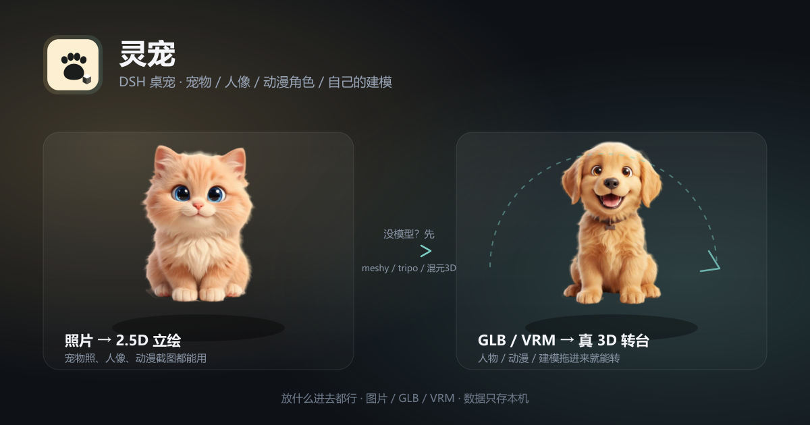

# dsh-pet-lingchong · 灵宠



一只住在 DSH 里的桌面灵宠：布偶猫、金毛、水豚三只常驻，也能把它换成你自己的宠物
（照片变 2.5D 立绘，GLB 变真 3D）。轻叩蓄能、会眨眼、会打盹，拖到哪儿待在哪儿。

- **悬浮卡**：整屏浮层上一只可拖的灵宠，轻叩 +1 能量，连击出星星眼
- **侧栏面板**：换宠 / 显隐 / 音效 / 飘字特效 / 大小滑杆
- **放什么进去都行**：宠物、人像、动漫角色、自己的建模 —— 照片变 2.5D 立绘，GLB / VRM / STL / OBJ / PLY 变真 3D 转台
- 数据全在本机（localStorage + IndexedDB），不联网、不上传、无云端 Key

## 能做什么 / 现在哪些真能跑起来

「离开宿主界面」的两条路都要宿主配合，现状如下（本机实测口径）：

| 能力 | 纯浏览器 | DSH 桌面端（Electron 44） |
| --- | --- | --- |
| 悬浮卡 / 侧栏面板 / 完整页面 / 导入照片与 GLB | ✅ | ✅ |
| **投到 Windows 桌面**（真透明、无边框、可穿透的独立窗） | ❌ 网页安全模型做不到 | ❌ **宿主目前没这个能力**，插件侧无从实现；代码按约定留好，宿主哪天给窗口就自动生效 |
| **置顶小窗**（Document PiP，压在所有程序之上） | ✅ Chromium 116+ | ❌ **Electron 未实现该 API**（`requestWindow()` 不开窗，electron/electron#39633），入口已自动隐藏 |

也就是说：**真桌宠（贴壁纸/置顶悬浮）目前需要宿主先加能力，或另做一个原生小壳**。
浏览器里打开同一个页面时，PiP 小窗是现在唯一可用的「离开界面」通道。

## 安装

```sh
dsh plugin --profile desktop add github:nszm/dsh-pet-lingchong
```

也可以「组件与生态 → DSH 插件 → 从文件夹安装」选择本目录。装完热重挂，无需重启。

要求：宿主提供 `slots` 与 `uiSession`（DSH 桌面端自带）。「投到桌面」「置顶小窗」
这类离开主界面的能力由宿主决定：宿主不支持时对应入口自动隐藏，其余功能照常，
不会出现点了没反应的按钮。

## 用法

| 想干什么 | 怎么做 |
| --- | --- |
| 蓄能 | 轻叩灵宠（或舞台页按空格） |
| 换宠 | 侧栏「🐾 灵宠」→ 点胶囊头像 |
| 挪窝 | 直接拖灵宠；位置按窗口百分比记，换分辨率不丢 |
| 投到桌面 | 浮层里右键灵宠 →「放到 Windows 桌面」（**需要宿主支持**，DSH 桌面端暂未提供；主项目那套 WebView2 壳可以） |
| 置顶小窗 | 侧栏面板 →「弹出小窗」（**仅纯浏览器**；Electron 宿主里这个入口不会出现） |
| 调大小 | 悬停灵宠按 **Ctrl + 滚轮**（30%–300% 无级）；或侧栏面板 / 灵宠 → 设置 里的「大小」滑杆 |
| 关掉转台 | 设置 → 互动 →「3D 自动旋转」关掉，模型就站着不动；舞台页仍可拖着转 |

## 放什么进去都行：宠物 / 人像 / 动漫角色 / 你自己的建模

> **「灵宠」只是名字，它不挑内容。**
> 猫狗照片、喜欢的动漫立绘、你自己捏的人物、手办扫描、Blender 里做的模型 —— 都能放进来当主角。
> 图片走 2.5D（会眨眼、会笑），**GLB / VRM / STL / OBJ / PLY 走真 3D**（three.js 转台、可拖着旋转、跟着大小缩放）。
> 没有模型？下面六个都能把照片 / 一句话变成 3D —— 额度是 2026-10 的公开信息，官方随时会调；
> 插件本身不代发、不上传，生成走你自己的账号。

| 站点 | 免费额度 | 注意 |
| --- | --- | --- |
| [腾讯混元 3D](https://3d.hunyuan.tencent.com) | 每天 20 积分 = **20 个** | 国内直连；自带智能拓扑（三角转四边）、自动 UV、自动绑骨 |
| [3D AI Studio](https://www.3daistudio.com) | 每月 1000 credits ≈ **100 个资产** | 下载的模型归你自己，额度最宽松 |
| [HuggingFace Space](https://hf-mirror.com/spaces) | 免注册，但要排队 | Hunyuan3D-2 / TripoSR / TRELLIS / Stable Fast 3D，可直接下 GLB；国内走 hf-mirror |
| [meshy.ai](https://www.meshy.ai/?utm_source=meshy&utm_medium=referral-program&utm_content=6RD3HF&share_type=invite-friends) | 每月 100 积分 ≈ 3~5 个 | 免费版 CC BY 4.0：可商用，但必须署名 |
| [tripo3d.ai](https://www.tripo3d.ai) | 每月 200 积分 ≈ 8 个 | 免费版不可商用，且生成的模型会公开 |
| [Hyper3D Rodin](https://hyper3d.ai) | 生成不限次、全部免费 | **下载要付费** —— 适合先免费看效果，满意再换别家出 |

| 你给什么 | 得到什么 |
| --- | --- |
| 一张照片（JPG / PNG / WebP） | 2.5D 立绘：宠物照、人像、动漫截图都行；自动柔边去背，标两只眼睛后能眨眼、笑、惊吓 |
| **GLB / VRM** | 真 3D：带材质与动画，转台 + 拖拽旋转，悬浮卡、舞台、桌面窗都是同一个模型（VRM 的 MToon 材质会退化成标准材质，颜色略灰） |
| **STL / OBJ / PLY** | 真 3D：按中性材质渲染（STL 本身没有颜色）；扫描件、3D 打印件、老素材都能直接拖 |

导入 3D 时如果没挑照片，插件会**用模型本身渲一张封面** —— 图鉴、换宠胶囊里看到的就是你的模型，不再是一块「3D」渐变占位。
| 两者都不给 | 内置的布偶猫 / 金毛 / 水豚，开箱即用 |

> `.gltf` / FBX / 3DS / DAE 请先转成 GLB：`.gltf` 是 JSON + 外部 `.bin` 与贴图，单文件导入必然缺资源；
> FBX 等格式的材质与骨骼解析代价大得多。Blender 打开另存为 glTF 2.0（.glb）即可，模型精度不变。

3 步导入：

1. 侧栏「🐾 灵宠」→ 打开完整页面 → 「导入灵宠」（或舞台上的 ＋）；
2. 选文件：图片进「标眼睛」流程；**GLB / VRM 直接跳到起名字**，导入页当场就能拖着看模型；
3. 起名字 → 请它入驻。内置三只之后最多再加 **5 个**（图片 + 3D 合计），随时可移除。

插件本身不调用任何云端接口：生成模型的过程在你的浏览器里、用你自己的账号完成。

## 数据存哪

| 内容 | 位置 |
| --- | --- |
| 今日能量 / 累计 / 陪伴日记 / 七日心流 | `localStorage` `lijing.pet.progress.v1` |
| 当前上屏的灵宠 | `localStorage` `lijing.pet.pet.v1` |
| 音效 / 特效 / 心愿等设置 | `localStorage` `lijing.pet.settings.v1` |
| 导入的宠物（图片、头像） | IndexedDB `lijing-pets` |
| 导入的 3D 模型 | IndexedDB `dsh-pet-lingchong-models` |
| 悬浮卡位置 / 显隐 | `localStorage` `dsh-pet-lingchong.pos.v1` / `.visible.v1` |

键名沿用灵宠页的老口径，方便与同源页面共用一份存档。

## 开发

```bash
node scripts/build.mjs           # 先按插件裁剪 Tailwind（只扫本插件 src），再 esbuild → lib/client.js
# 三个「照片 → 3D」站点的链接集中在 src/pets/threeD.ts：换推广 / 邀请码只改那一处,
# 导入向导与设置面板同时生效（README 里的链接要手动同步）。
node scripts/verify-bundle.mjs   # 契约 + SSR 冒烟 + 样式/素材随包，41 条断言
npm run check                    # tsc + verify（需要主项目仓库的 typescript）
```

改完必须重新构建：DSH 加载的是 `lib/client.js` 产物，不是源码；`lib/` 按纪律入库。
不写 prepare / postinstall，安装管线不跑构建脚本。

```
src/client.tsx      apply(ctx)：注册样式 + 两个座位（shell.overlay / sidebar.footer.action）
src/overlay.tsx     悬浮灵宠卡（拖拽 / 轻叩 / 气泡）+ 侧栏面板
src/pets/           灵宠数据、表情层、粒子、舞台、3D 渲染、导入管线
src/pip.tsx         Document PiP 小窗
css/                pet.css（令牌 + 动画）、overlay.css（ljp-* 壳）、utilities.css
```

## 边界

- 不是沙箱：和所有 DSH 插件一样，跑在宿主 WebView 的完整 DOM/JS 权限下；
- **桌面窗、置顶小窗都不由插件创建**，是宿主窗口能力的投影：
  - 桌面透明窗需要宿主开 `transparent + frameless + alwaysOnTop` 的窗口并把插件画进去
    （插件侧已按 `html.lj-dsh-desktop-html` 这个约定适配好，宿主给了类名就居中显示）；
  - 置顶小窗走 Document PiP，Chromium 有、Electron 没有，所以只在浏览器里出现；
- 30 秒无互动会打盹，叩一下惊醒 —— 桌宠的本分。

## 许可

BSD-3-Clause，见 [LICENSE](LICENSE)。
